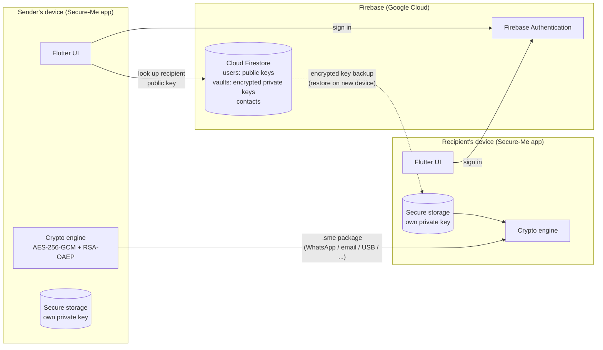
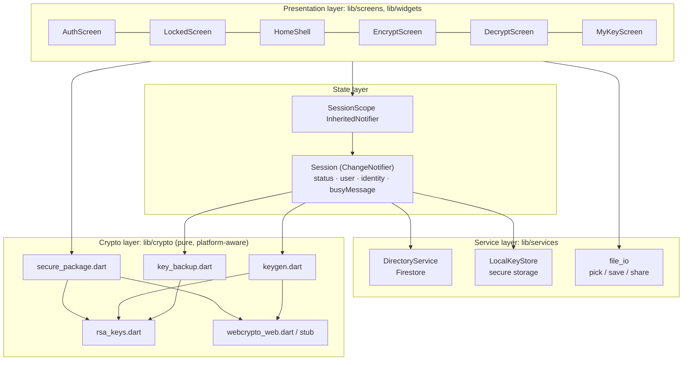
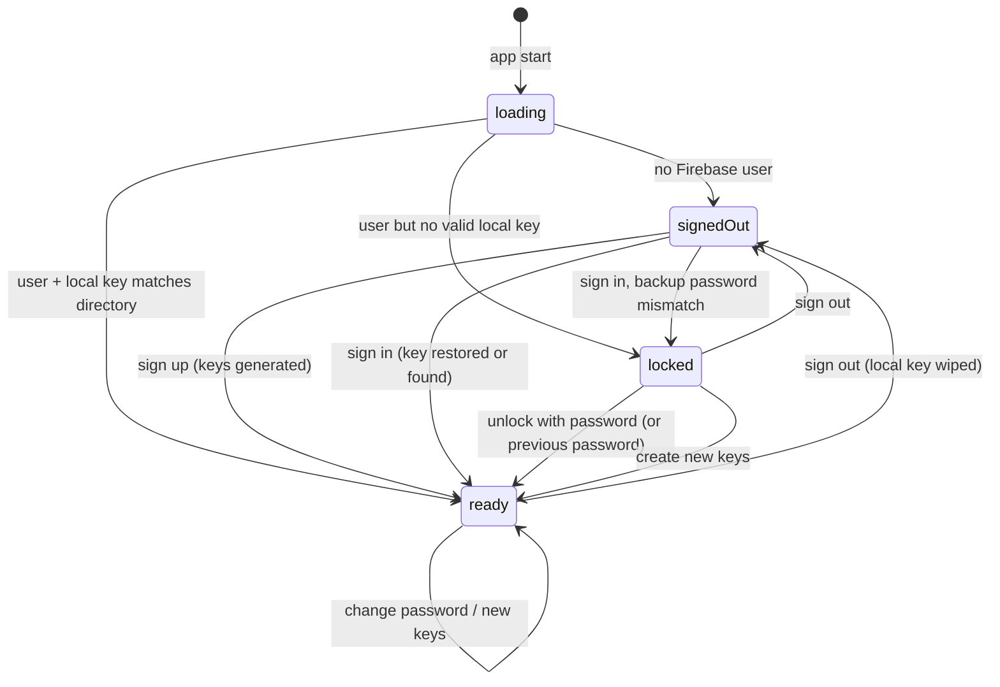
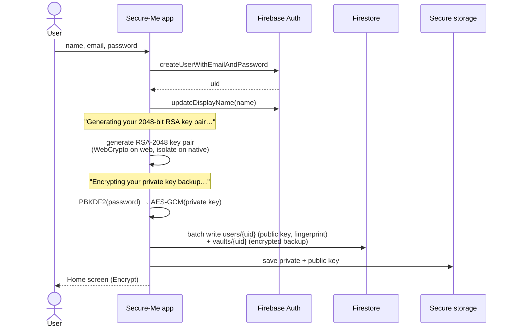
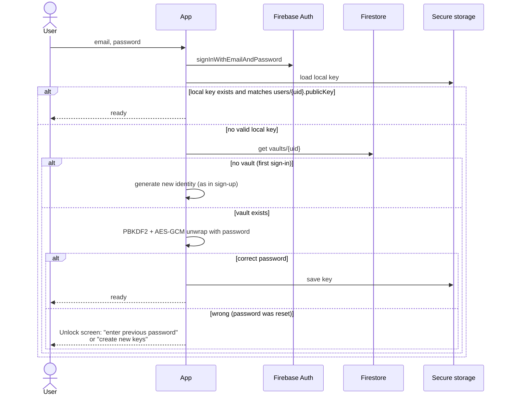
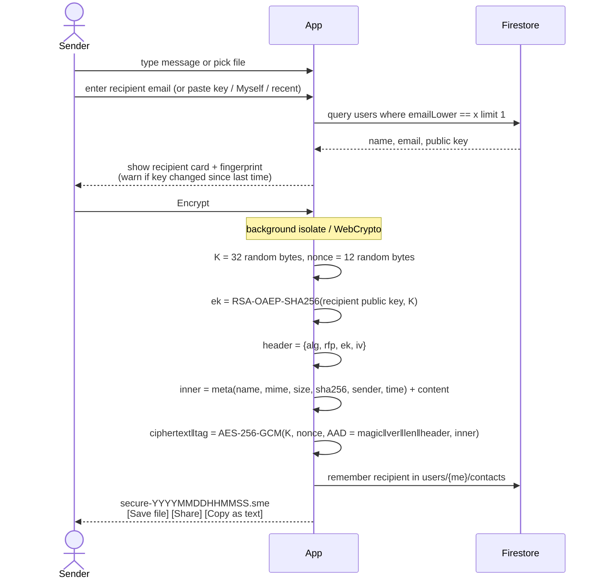
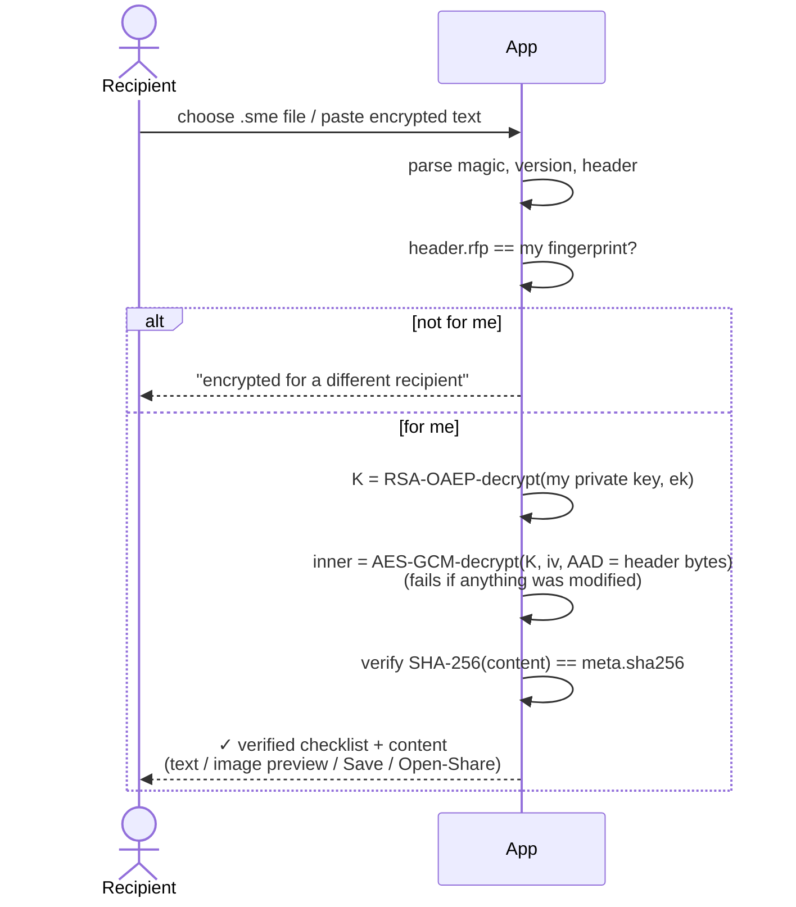

# Secure-Me: Complete Project Documentation

**Secure End-to-End Encrypted File Sharing Platform**
Built with Flutter and Firebase · Android · iOS · Web · macOS

| | |
|---|---|
| **Team** | Pravesh Chaudhary (23036245) · Jaanhvi Shukla (23036126) · Harsh Kumar (23036123) |
| **Mentor** | Dr. Rajesh Mahule |
| **Firebase project** | `secure-me-06k3q` (Firestore region `asia-south1`) |
| **Cryptography** | AES-256-GCM · RSA-2048 OAEP (SHA-256) · PBKDF2-HMAC-SHA256 · SHA-256 |

> Diagrams in this document are written in Mermaid. They render on GitHub, GitLab, in VS Code (Markdown Preview Mermaid extension) and in most Markdown viewers.

---

## Table of Contents

1. [Introduction](#1-introduction)
2. [Problem Statement](#2-problem-statement)
3. [Objectives and How Each Is Met](#3-objectives-and-how-each-is-met)
4. [Changes from the Original Synopsis](#4-changes-from-the-original-synopsis)
5. [Features](#5-features)
6. [System Architecture](#6-system-architecture)
7. [Technology Stack](#7-technology-stack)
8. [Cryptographic Design](#8-cryptographic-design)
9. [The `.sme` Encrypted Package Format](#9-the-sme-encrypted-package-format)
10. [Key Management](#10-key-management)
11. [Application Workflows (Step by Step)](#11-application-workflows-step-by-step)
12. [Firebase Backend](#12-firebase-backend)
13. [Source Code Structure (Module by Module)](#13-source-code-structure-module-by-module)
14. [User Interface (Screen by Screen)](#14-user-interface-screen-by-screen)
15. [Platform-Specific Implementation](#15-platform-specific-implementation)
16. [How the Project Was Built](#16-how-the-project-was-built)
17. [Testing and Verification](#17-testing-and-verification)
18. [Performance](#18-performance)
19. [Security Analysis](#19-security-analysis)
20. [Setup, Running and Deployment](#20-setup-running-and-deployment)
21. [Limitations](#21-limitations)
22. [Future Scope](#22-future-scope)
23. [Glossary](#23-glossary)
24. [References](#24-references)

---

## 1. Introduction

Secure-Me is a secure file-sharing application that protects users' data while it is stored and while it is transferred. A user can take a **text message, image, audio file, video or document**, encrypt it for one **specific recipient**, and get back a single portable encrypted file (a `.sme` package). The user can send that file through any channel, such as WhatsApp, email, Google Drive, Bluetooth or a USB drive. Only the intended recipient can decrypt it and recover the original.

The key design decision is that **the files never touch our server**. All encryption and decryption happen on the user's own device. Firebase handles only two things:

1. **User accounts** (Firebase Authentication).
2. **A public-key directory** (Cloud Firestore), so users can look up a recipient's public key by email. It also stores each user's private key, but only in encrypted form.

Because the server never sees a file or a usable private key, a compromise of the server, the database, a user's account or a sharing link does not expose any file contents.

---

## 2. Problem Statement

Traditional file-sharing platforms such as cloud drives, messengers with server-side storage and shared links usually have one or more of these weaknesses:

- **The server can read the files.** If the server or database is breached, every stored file is exposed.
- **Links are bearer tokens.** Anyone who gets hold of a sharing link can open the file.
- **Account compromise means data compromise.** A stolen password gives access to everything.
- **There is no guarantee of integrity.** A file can be silently modified in transit or in storage.

Secure-Me solves this with **recipient-specific hybrid encryption**. Each file is encrypted with a fresh symmetric key, and that key is locked so that only the recipient's private key, which never leaves their device unencrypted, can unlock it. Any modification to the encrypted file is detected and the file is rejected.

---

## 3. Objectives and How Each Is Met

| # | Objective (from synopsis) | How Secure-Me implements it | Where in code |
|---|---|---|---|
| 1 | Secure file-sharing app with user authentication | Firebase Authentication (email + password), re-authentication for sensitive actions, password reset by email | `lib/services/session.dart` |
| 2 | Encrypt files using **AES-256-GCM** | Every package is encrypted with a new random 256-bit AES key and a 96-bit nonce, using AES-GCM with a 128-bit authentication tag | `lib/crypto/secure_package.dart` |
| 3 | Protect the AES key using the recipient's **RSA public key** | The AES key is encrypted with **RSA-OAEP (SHA-256, MGF1-SHA-256)** using the recipient's 2048-bit RSA public key | `secure_package.dart`, `webcrypto_web.dart` |
| 4 | Generate a portable encrypted file/package | A self-contained binary `.sme` file, plus a text-armored form for chat apps | `secure_package.dart` |
| 5 | Only the intended recipient can decrypt, using their private key | Each package records the recipient's key fingerprint. Only the matching private key can unwrap the AES key | `decryptPackage()` |
| 6 | File integrity verification and secure downloading | The AES-GCM tag covers both the header (as AAD) and the content. A separate SHA-256 hash of the original is checked too. Decrypted files are saved through the OS save dialog or share sheet | `decryptPackage()`, `file_io.dart` |

---

## 4. Changes from the Original Synopsis

The synopsis proposed **React.js + FastAPI + PostgreSQL/MySQL**. The project was implemented with **Flutter + Firebase** instead. The security design (AES-256-GCM + RSA-OAEP hybrid encryption) is **unchanged**.

| Aspect | Synopsis | Implemented | Why |
|---|---|---|---|
| Frontend | React.js, HTML, CSS, JS | **Flutter (Dart)** | One codebase for Android, iOS, web and macOS. The synopsis listed "mobile application support" as future scope, and it is now built in from day one. |
| Backend | Python FastAPI | **Firebase** (serverless) | No server code to write, host or secure. Authentication and database come with security rules. |
| Database | PostgreSQL / MySQL | **Cloud Firestore** | Holds only profiles, public keys and encrypted key backups. Access control is enforced by declarative security rules. |
| File storage | (server) | **None. Files are never uploaded.** | Strongest privacy: there is nothing on the server to leak. The user shares the encrypted package directly. |
| Encryption location | (unspecified) | **On the device only** | True end-to-end encryption. The server is never trusted with plaintext or keys. |
| HTTPS | HTTPS | HTTPS/TLS (all Firebase traffic) | Same |

---

## 5. Features

### Core
- **Sign up / sign in** with email and password.
- **Automatic key generation:** a 2048-bit RSA key pair is created on the device at sign-up.
- **Encrypt a message or any file** (images, audio, video, PDFs, documents, anything) up to 100 MB.
- **Choose the recipient** in one of three ways:
  - **Find by email:** looks up the recipient's public key in the directory.
  - **Paste a public key:** accepts PEM or raw base64, so the recipient doesn't even need to be in the directory.
  - **"Myself"** and **recent contacts** as quick chips.
- **Decrypt** by opening a `.sme` file or pasting an encrypted text message.
- **Previews after decryption:** text is shown inline with a copy button and images are previewed. Any file can be saved, or opened and shared with another app.

### Security features
- **Integrity verification checklist** shown after every decryption:
  1. The package was encrypted for your key (fingerprint matches).
  2. RSA-OAEP unlocked the file key with your private key.
  3. The AES-256-GCM authentication tag is valid (not tampered with).
  4. The SHA-256 of the original matches.
- **Clear error for the wrong recipient:** "This package was encrypted for a different recipient", along with the intended key's fingerprint.
- **Key fingerprints:** a SHA-256 hash of the public key, shown in groups (e.g. `ACF0 79BE 359D …`), so users can confirm a key in person.
- **Key-change warning:** if a saved contact's key has changed since you last sent to them, the app warns you, because that could mean the key was swapped.
- **Hidden file names:** the outer file is always `secure-<timestamp>.sme`. The real name and type are inside the encryption.
- **Encrypted private-key backup:** you can sign in on any device and get the same key, but only your password can unlock it.
- **Change password** re-encrypts the key backup.
- **Forgot password** recovery: unlock with the old password, or generate new keys.
- **Generate new keys** (key rotation) if a key is suspected to be compromised.
- **Sign out wipes the private key** from the device.

### Usability
- **Copy as text** for messages: the package becomes a `-----BEGIN SECURE-ME MESSAGE-----` block that can be pasted into any chat.
- **Share sheet integration** (WhatsApp, Mail, AirDrop, etc.).
- **Responsive layout:** bottom navigation bar on phones, side navigation rail on tablets and desktops.
- **Light and dark themes** that follow the system setting.
- A built-in **"How Secure-Me works"** explainer.

---

## 6. System Architecture

### 6.1 High-level architecture



**Important:** the arrow carrying the `.sme` package **does not pass through Firebase**. The package moves over whatever channel the user chooses, and it is useless to anyone who intercepts it.

### 6.2 Layered architecture inside the app



**Design principles:**
- **The crypto layer has no UI or Firebase dependencies.** It takes bytes in and gives bytes out, so it can be unit-tested in isolation and run in background isolates.
- **A single source of truth for auth and key state** (`Session`). The root widget switches between screens based on `Session.status`.
- **Heavy work runs off the UI thread.** On native platforms, key generation, PBKDF2 and encryption/decryption run in a background isolate through `compute()`. On web, they use the browser's native asynchronous WebCrypto.

### 6.3 Application state machine



| State | Screen shown | Meaning |
|---|---|---|
| `loading` | spinner | Waiting for Firebase to restore the session |
| `signedOut` | `AuthScreen` | No user is signed in |
| `locked` | `LockedScreen` | Signed in, but the private key isn't available on this device yet |
| `ready` | `HomeShell` (Encrypt / Decrypt / My key) | Fully usable |

While a long operation runs (key generation, PBKDF2), `Session.busyMessage` is set and a full-screen progress overlay is shown, for example *"Generating your 2048-bit RSA key pair…"*.

---

## 7. Technology Stack

### Languages and frameworks

| Layer | Technology | Version |
|---|---|---|
| Language | Dart | SDK ^3.9.2 |
| UI framework | Flutter (Material 3) | 3.35.5 (stable) |
| Authentication | Firebase Authentication | `firebase_auth` 6.5.x |
| Database | Cloud Firestore | `cloud_firestore` 6.x |
| Firebase core | `firebase_core` | 4.13.x |
| Hosting (optional, web) | Firebase Hosting | — |

### Dart packages and what each is used for

| Package | Purpose in Secure-Me |
|---|---|
| `firebase_core` | Initializes Firebase on each platform |
| `firebase_auth` | Sign up, sign in, sign out, re-authentication, password change and reset |
| `cloud_firestore` | Public-key directory, encrypted key vault, recent contacts |
| `cryptography` | **AES-256-GCM**, **PBKDF2**, **SHA-256**. It uses the browser's WebCrypto on web and an optimised pure-Dart implementation on other platforms. |
| `pointycastle` | **RSA key generation** (native), **RSA-OAEP** (native), ASN.1 parsing |
| `basic_utils` | RSA key ↔ DER encoding (PKCS#8 private, X.509 SubjectPublicKeyInfo public) |
| `crypto` | SHA-256 for key fingerprints |
| `web` | Dart bindings to the browser **WebCrypto API** (RSA on web) |
| `flutter_secure_storage` | Stores the private key in the platform keystore (Keychain, Android encrypted storage, browser storage) |
| `file_picker` | Pick files to encrypt or decrypt, and the save-file dialog |
| `share_plus` | OS share sheet for packages, decrypted files and public keys |
| `mime` | Detects a file's MIME type from its name and magic bytes |
| `collection` | Byte-list equality (comparing public keys) |

### Tooling
- **Firebase CLI** (15.15): project creation, Firestore database creation, rules deployment.
- **FlutterFire CLI** (1.4): generates `lib/firebase_options.dart` and registers the apps.
- **gcloud CLI**: enables the Google Cloud APIs.
- **CocoaPods**: iOS and macOS native dependencies.
- **Gradle / Kotlin 2.3.0**: Android build.
- **OpenSSL and Node.js**: independent interoperability verification of the encryption format.

---

## 8. Cryptographic Design

### 8.1 Primitives used

| Purpose | Algorithm | Parameters | Why this choice |
|---|---|---|---|
| Encrypt the content | **AES-256-GCM** | 256-bit key, 96-bit random nonce, 128-bit tag | Authenticated encryption, which gives confidentiality **and** integrity in one step. It is the industry standard (TLS 1.3, Signal, WhatsApp). |
| Protect the AES key | **RSA-OAEP** | 2048-bit modulus, e = 65537, SHA-256, MGF1-SHA-256 | Public-key encryption, so anyone can encrypt for the recipient but only the recipient can decrypt. OAEP padding is provably secure and recommended by PKCS#1 v2.2. |
| Derive the key that protects the backup | **PBKDF2-HMAC-SHA256** | 100,000 iterations, 128-bit random salt, 256-bit output | Turns a password into a key and makes password guessing slow |
| Encrypt the private-key backup | **AES-256-GCM** | Key from PBKDF2, 96-bit random nonce | The wrong password is detected reliably, because the tag check fails |
| Integrity of the original | **SHA-256** | — | Independent check that the recovered file is identical to the original |
| Key fingerprint | **SHA-256** of the public key (SPKI DER) | 64 hex characters | A short, human-comparable identity for a key |
| Randomness | **OS CSPRNG** (`Random.secure()`) | — | AES keys, nonces and salts. On native, RSA key generation uses Fortuna seeded from the OS CSPRNG. |

### 8.2 Why hybrid encryption?

RSA can only encrypt very small data. With a 2048-bit key and OAEP-SHA256, the maximum is 190 bytes, and RSA is slow. AES is fast and can encrypt gigabytes, but both sides need the same secret key. **Hybrid encryption combines the strengths of both:**

```
                 ┌─────────────── random AES-256 key K (32 bytes) ───────────────┐
                 │                                                                │
  original file ─┴─► AES-256-GCM(K, nonce, AAD=header) ─► ciphertext + tag        │
                                                                                  │
  recipient's RSA public key ──► RSA-OAEP-SHA256(K) ─► wrapped key (256 bytes) ◄──┘

  .sme package = header{ wrapped key, nonce, recipient fingerprint } + ciphertext + tag
```

To decrypt, the recipient uses their RSA **private** key to unwrap K, and then uses K to decrypt the content with AES-GCM.

### 8.3 Properties this gives

| Property | How it's achieved |
|---|---|
| **Confidentiality** | Only the holder of the recipient's private key can recover K, and without K the AES-256 ciphertext cannot be read |
| **Recipient specificity** | K is wrapped with exactly one public key. A different private key fails to unwrap it, and the fingerprint check catches the mismatch first. |
| **Integrity and tamper detection** | The GCM tag authenticates the ciphertext **and** the entire header (used as AAD). Changing any byte anywhere makes decryption fail. |
| **Fresh key per package** | Each package uses a new random K and nonce, so compromising one package's key reveals nothing about any other package |
| **Metadata privacy** | The file name, MIME type, size, sender and timestamp are inside the encrypted part. Only the recipient fingerprint is public, and it is needed for routing. |
| **No nonce reuse** | A fresh K is used every time, so the 96-bit random nonce never repeats under the same key |

### 8.4 Key fingerprints

```
fingerprint = UPPERCASE_HEX( SHA-256( public key in X.509 SubjectPublicKeyInfo DER ) )
displayed as  ACF0 79BE 359D EBAA 7CF8 8C69 F290 42AD E089 5A8D 7448 3C59 5B0C F4B6 C811 50D6
```

Two people can compare the fingerprint over a phone call or in person. If it matches, nobody has substituted the key, which defeats a man-in-the-middle attack through the directory. The encoding is byte-identical to OpenSSL's, so the fingerprint can also be checked with standard tools:

```bash
openssl pkey -pubin -in key.pem -outform DER | openssl dgst -sha256
```

---

## 9. The `.sme` Encrypted Package Format

### 9.1 Binary layout

```
Offset  Size        Field
──────  ──────────  ─────────────────────────────────────────────────────────────
0       8 bytes     Magic: ASCII "SECUREME"  (53 45 43 55 52 45 4D 45)
8       1 byte      Format version = 1
9       4 bytes     Header length H (unsigned 32-bit, big-endian)
13      H bytes     Header (UTF-8 JSON, public)                     ┐
                                                                    ├─ all of bytes 0…13+H
13+H    N bytes     AES-256-GCM ciphertext                          │   are the GCM AAD
end-16  16 bytes    AES-GCM authentication tag                      ┘
```

### 9.2 Public header (JSON)

```json
{
  "alg": "RSA-OAEP-SHA256 + AES-256-GCM",
  "rfp": "ACF079BE359DEBAA7CF88C69F29042ADE0895A8D74483C595B0CF4B6C81150D6",
  "ek":  "<base64 of the 256-byte RSA-OAEP-encrypted AES key>",
  "iv":  "<base64 of the 12-byte GCM nonce>"
}
```

| Field | Meaning |
|---|---|
| `alg` | Algorithm suite identifier |
| `rfp` | **R**ecipient **f**ingerprint. Lets the app say "not for you" before trying to decrypt. |
| `ek` | **E**ncrypted **k**ey: the AES key wrapped with RSA-OAEP |
| `iv` | GCM nonce |

### 9.3 Encrypted payload (what's inside the GCM ciphertext)

```
4 bytes   Metadata length M (big-endian)
M bytes   Metadata (UTF-8 JSON)
rest      Original content bytes
```

```json
{
  "kind": "file",                       // "text" or "file"
  "name": "holiday-video.mp4",
  "mime": "video/mp4",
  "size": 18374421,
  "sha256": "9f2c…",                    // SHA-256 of the original content
  "created": "2026-10-22T17:59:40.120Z",
  "sender": { "name": "Pravesh", "email": "p@example.com", "fp": "ACF0…" }
}
```

### 9.4 Text-armored form

For text messages smaller than 256 KB, the app can also produce a copy-pasteable version (standard base64 of the same binary package, wrapped at 64 characters):

```
-----BEGIN SECURE-ME MESSAGE-----
U0VDVVJFTUUBAAABJnsiYWxnIjoiUlNBLU9BRVAtU0hBMjU2ICsgQUVTLTI1Ni1H
…
-----END SECURE-ME MESSAGE-----
```

### 9.5 Decryption checks (in order)

| Step | Check | Error shown if it fails |
|---|---|---|
| 1 | Starts with `SECUREME` and is at least 13 bytes | "Not a Secure-Me package." |
| 2 | Version byte = 1 | "Unsupported package version N." |
| 3 | Header length fits inside the file | "Package is truncated or corrupted." |
| 4 | Header is valid JSON | "Package header is corrupted." |
| 5 | `rfp` equals my fingerprint | "This package was encrypted for a different recipient." (shows the intended fingerprint) |
| 6 | RSA-OAEP unwrap of `ek` succeeds | "Could not unlock the file key with your private key." |
| 7 | AES-GCM tag verifies (header + ciphertext) | "Integrity check failed: the package was modified or corrupted." |
| 8 | SHA-256(content) equals `meta.sha256` | "Integrity check failed: SHA-256 mismatch." |

### 9.6 Standards compliance

The format uses only standard primitives with standard encodings, and this was verified independently. A package created by Secure-Me was decrypted by a separate Node.js/OpenSSL program, using `crypto.privateDecrypt` with OAEP SHA-256 and `aes-256-gcm` with `setAAD` and `setAuthTag`. In the other direction, an OpenSSL-generated PKCS#8 key works inside Secure-Me (see §17.3).

---

## 10. Key Management

### 10.1 Where keys live

| Key | Generated where | Stored where | Who can read it |
|---|---|---|---|
| **RSA public key** | User's device | Firestore `users/{uid}.publicKey` (base64 X.509 DER), plus local secure storage | Any signed-in user, which is required so others can encrypt for you |
| **RSA private key (plaintext)** | User's device | **Only** in the device's secure storage (`priv_<uid>`) | Only the app on that device. It is wiped at sign-out. |
| **RSA private key (encrypted backup)** | User's device | Firestore `vaults/{uid}.backup` | Only the owner (enforced by security rules), and even then it is useless without the password |
| **AES content key** | Fresh per package | Only inside the package, RSA-wrapped | Only the recipient |
| **Backup key** (from password) | Derived on demand with PBKDF2 | **Never stored** | — |

### 10.2 Private-key backup ("vault") format

```json
{
  "alg": "PBKDF2-HMAC-SHA256 + AES-256-GCM",
  "iterations": 100000,
  "salt": "<base64, 16 random bytes>",
  "iv":   "<base64, 12 random bytes>",
  "ct":   "<base64 of AES-GCM(ciphertext || 16-byte tag) of the PKCS#8 private key>"
}
```

```
backupKey = PBKDF2-HMAC-SHA256(password, salt, 100 000 iterations, 32 bytes)
ct        = AES-256-GCM-Encrypt(backupKey, iv, privateKeyPKCS8)
```

A wrong password makes the GCM tag check fail, which the app reports as `WrongPasswordException`.

### 10.3 Key formats

| Item | Encoding |
|---|---|
| Public key | X.509 **SubjectPublicKeyInfo** DER (base64 in Firestore, PEM when shared) |
| Private key | **PKCS#8** DER |
| Shared public key text | Standard PEM: `-----BEGIN PUBLIC KEY----- … -----END PUBLIC KEY-----` |

Keys pasted by a user are accepted as PEM or as bare base64 DER. They are rejected if they are malformed or shorter than 2048 bits.

### 10.4 Key lifecycle events

| Event | What happens to the keys |
|---|---|
| **Sign up** | A new key pair is generated, the backup is wrapped with the password, the public key and backup are published (in one atomic batch), and the private key is saved locally |
| **Sign in on the same device** | The local key is found and checked against the directory, and the app is ready immediately |
| **Sign in on a new device** | The backup is downloaded and unwrapped with the password, and the key is saved locally |
| **App restart** | The local key is loaded and compared with the published public key |
| **Keys reset on another device** | On the next start the local key no longer matches the directory, so it is wiped and the user must unlock again |
| **Change password** | The backup is re-wrapped with the new password and uploaded. The key pair itself is unchanged. |
| **Forgot password (email reset)** | The backup is still locked with the **old** password. The user enters the old password once, and the backup is re-wrapped with the new one. Alternatively they generate new keys. |
| **Generate new keys** | A new pair is created and replaces the published key and the backup. Old packages can no longer be opened. |
| **Sign out** | The local private key is deleted from the device. The encrypted backup stays in Firestore. |

---

## 11. Application Workflows (Step by Step)

### 11.1 Sign up



If the account is created but publishing the keys fails (for example, no network), the user lands on the unlock screen. Unlocking finds no vault and retries key creation.

### 11.2 Sign in and key restore



### 11.3 Encrypting a message or file



### 11.4 Decrypting



### 11.5 Other flows

| Flow | Steps |
|---|---|
| **Change password** | Enter current and new password, re-authenticate with Firebase, wrap the private key with the new password, `updatePassword`, then upload the new vault |
| **Forgot password** | Enter email, see a dialog explaining the key-backup implications, and Firebase sends a reset email. At the next sign-in, the backup still uses the old password, so the Unlock screen asks for it once and re-wraps the backup. |
| **Generate new keys** | Confirm in a red danger dialog, enter the password, re-authenticate, generate and publish a new identity (overwriting the old one) |
| **Edit name** | Updates the Firebase Auth display name and `users/{uid}.displayName` |
| **Share my public key** | My key → Copy key / Share key, which sends the PEM with a short message |

---

## 12. Firebase Backend

### 12.1 Services used

| Service | Use | Plan |
|---|---|---|
| **Authentication** | Email/password provider | Free (Spark) |
| **Cloud Firestore** | Directory, vaults, contacts (`asia-south1`, Mumbai) | Free (Spark) |
| **Hosting** *(optional)* | Serve the web build | Free (Spark) |
| ~~Cloud Storage~~ | **Not used.** Files are never uploaded. | — |

The whole project therefore runs on the **free plan**, with no billing account needed.

### 12.2 Firestore data model

```
users/{uid}                                   ← public directory entry
  displayName   : string    "Pravesh Chaudhary"
  email         : string    "pravesh@example.com"
  emailLower    : string    "pravesh@example.com"   (for case-insensitive lookup)
  publicKey     : string    base64 X.509 DER RSA public key
  fingerprint   : string    64 hex chars (SHA-256 of publicKey DER)
  keyUpdatedAt  : timestamp

users/{uid}/contacts/{contactUid}             ← my recent recipients (private)
  displayName   : string
  email         : string
  fingerprint   : string    the contact's fingerprint when last used
  lastUsed      : timestamp

vaults/{uid}                                  ← my encrypted private key (private)
  backup        : map { alg, iterations, salt, iv, ct }
  updatedAt     : timestamp
```

**What Firestore never contains:** file contents, file names, messages, plaintext private keys, AES keys or passwords.

### 12.3 Security rules (`firestore.rules`)

```js
rules_version = '2';
service cloud.firestore {
  match /databases/{database}/documents {
    function signedIn() { return request.auth != null; }
    function isOwner(uid) { return signedIn() && request.auth.uid == uid; }

    match /users/{uid} {
      allow get:  if signedIn();                                   // look up one user
      allow list: if signedIn() && request.query.limit <= 1;       // no bulk scraping
      allow create, update: if isOwner(uid) && validProfile(request.resource.data);
      allow delete: if false;

      function validProfile(d) {
        return d.keys().hasOnly(['displayName','email','emailLower','publicKey','fingerprint','keyUpdatedAt'])
          && d.email == request.auth.token.email                   // can't claim others' email
          && d.emailLower == request.auth.token.email.lower()
          && d.displayName is string && d.displayName.size() <= 100
          && d.publicKey is string && d.publicKey.size() <= 2048
          && d.fingerprint is string && d.fingerprint.size() == 64;
      }

      match /contacts/{contactUid} { allow read, write: if isOwner(uid); }
    }

    match /vaults/{uid} { allow read, write: if isOwner(uid); }

    match /{document=**} { allow read, write: if false; }          // deny everything else
  }
}
```

| Rule | Threat it prevents |
|---|---|
| `get` only when signed in | Anonymous scraping of the directory |
| `list` limited to 1 result | Downloading the whole user list or email list |
| Only the owner writes their profile | Replacing someone else's public key (a key-substitution attack) |
| `email == request.auth.token.email` | Registering a key under **someone else's email address** |
| `hasOnly([...])` and size limits | Injecting extra fields or very large documents |
| Vault: owner only | Other users downloading your encrypted private key for offline guessing |
| Default deny | Any collection not explicitly listed |

### 12.4 Firebase configuration files

| File | Purpose |
|---|---|
| `lib/firebase_options.dart` | Per-platform Firebase config (generated by FlutterFire) |
| `android/app/google-services.json` | Android Firebase config |
| `ios/Runner/GoogleService-Info.plist`, `macos/Runner/GoogleService-Info.plist` | Apple Firebase config |
| `firebase.json` | Firestore rules/index paths, Hosting config (`build/web`, SPA rewrite) |
| `.firebaserc` | Default project `secure-me-06k3q` |
| `firestore.rules` | Security rules |
| `firestore.indexes.json` | No composite indexes needed (only single-field queries) |

> Firebase API keys in these files are **not secrets**. They only identify the project. Access is controlled by Authentication and the security rules.

---

## 13. Source Code Structure (Module by Module)

```
Secure_Me/
├── lib/
│   ├── main.dart                        App entry, theme, root state switch
│   ├── firebase_options.dart            Generated Firebase config
│   ├── crypto/
│   │   ├── rsa_keys.dart                RSA identity, keygen, DER/PEM, fingerprints, CSPRNG
│   │   ├── keygen.dart                  Picks the fastest keygen per platform
│   │   ├── webcrypto_web.dart           Browser WebCrypto: RSA keygen + OAEP encrypt/decrypt
│   │   ├── webcrypto_stub.dart          Non-web placeholder (conditional import)
│   │   ├── secure_package.dart          .sme format: encrypt, decrypt, armor
│   │   └── key_backup.dart              Password-wrapped private key (PBKDF2 + AES-GCM)
│   ├── services/
│   │   ├── session.dart                 Auth + key lifecycle state machine, error messages
│   │   ├── directory_service.dart       Firestore: users, vaults, contacts
│   │   ├── local_key_store.dart         flutter_secure_storage wrapper
│   │   └── file_io.dart                 Pick, save, share files; MIME detection; size formatting
│   ├── screens/
│   │   ├── auth_screen.dart             Sign in / create account / forgot password
│   │   ├── locked_screen.dart           Restore key on this device / reset keys
│   │   ├── home_shell.dart              Navigation (bar or rail) + tabs
│   │   ├── encrypt_screen.dart          Encrypt flow + result view
│   │   ├── decrypt_screen.dart          Decrypt flow + verification + preview
│   │   └── my_key_screen.dart           Profile, public key, security settings, how-it-works
│   └── widgets/
│       └── common.dart                  SessionScope, overlays, cards, fingerprint text, dialogs
├── test/
│   ├── crypto_test.dart                 7 unit tests (native)
│   ├── web_crypto_test.dart             Browser test (WebCrypto path, real Chrome)
│   └── fixtures/                        OpenSSL-generated throwaway test key (PKCS#8 + SPKI)
├── firestore.rules                      Security rules
├── firestore.indexes.json
├── firebase.json / .firebaserc
├── README.md                            Quick start
└── doc.md                               This document
```

### 13.1 `lib/crypto/rsa_keys.dart`
- `RsaIdentity` holds `publicDer` (SPKI) and `privateDer` (PKCS#8). The decoded key objects and the fingerprint are computed lazily.
- `generateIdentity(bits)` generates the RSA pair with pointycastle (e = 65537, Fortuna PRNG seeded from the OS). It is used on native inside an isolate.
- `identityFromPrivate(der)` rebuilds the identity from the private key alone. It **reads n and e directly from the PKCS#8 structure** (see the bug fix in §16.6).
- `randomBytes(n)` uses the OS CSPRNG (`Random.secure()`).
- `keyFingerprint`, `formatFingerprint`, `publicKeyToPem`, and `parsePublicKeyInput`, which validates pasted keys: PEM or base64, valid RSA, at least 2048 bits.

### 13.2 `lib/crypto/keygen.dart`, `webcrypto_web.dart`, `webcrypto_stub.dart`
- Uses a **conditional import** (`if (dart.library.js_interop)`), so web builds get the WebCrypto implementation and native builds get a stub.
- `generateIdentityFast()`: on web it calls `crypto.subtle.generateKey('RSA-OAEP', 2048, SHA-256)` and exports PKCS#8. On native it runs `compute(generateIdentity, 2048)`.
- `webRsaOaepEncrypt` / `webRsaOaepDecrypt` import SPKI/PKCS#8 into WebCrypto and run OAEP natively in the browser.

### 13.3 `lib/crypto/secure_package.dart`
- `encryptPackage(EncryptRequest)` → `Future<Uint8List>`: implements §9 exactly.
- `decryptPackage(DecryptRequest)` → `Future<DecryptedPayload>`: runs all eight checks from §9.5.
- `peekRecipientFingerprint`, `armorPackage`, `dearmorPackage`, `isArmored`.
- Exceptions: `PackageException`, plus `NotForYouException` (which carries the intended fingerprint).
- `kMaxPayloadBytes = 100 MB`, `kAlgorithm`, `kPackageExtension = 'sme'`.
- AES-GCM and SHA-256 come from `package:cryptography` (WebCrypto on web). RSA-OAEP uses WebCrypto on web and pointycastle on native.

### 13.4 `lib/crypto/key_backup.dart`
- `wrapPrivateKey(WrapRequest)` and `unwrapPrivateKey(UnwrapRequest)`, with `WrongPasswordException`.
- `kPbkdf2Iterations = 100000`. The iteration count is stored in each backup, so it can be raised later without breaking old backups.

### 13.5 `lib/services/session.dart`
- `Session extends ChangeNotifier` with `status`, `user`, `identity`, `backupPasswordMismatch` and `busyMessage`.
- Public API: `init`, `signUp`, `signIn`, `unlock`, `resetKeys`, `changePassword`, `sendPasswordReset`, `updateDisplayName`, `signOut`.
- Private helpers: `_createIdentity`, `_restoreIdentity`, `_matchesDirectory` (detects keys rotated from another device; trusts the local key when offline), `_reauthenticate` and `_busy` (progress overlay plus a frame delay so the spinner paints before heavy work).
- `describeError()` turns Firebase error codes into friendly messages, e.g. *"Incorrect email or password."*

### 13.6 `lib/services/directory_service.dart`
- `Recipient` (a looked-up or pasted key) and `Contact` (a recent recipient with the fingerprint seen last time).
- `publishIdentity` does an **atomic batch write** of the profile and the vault.
- `findByEmail` (limit 1), `findByUid`, `fetchPublicKey`, `fetchVault`, `updateVault`, `updateDisplayName`, `contacts` (a live stream of the 12 most recent), `rememberContact` and `forgetContact`.

### 13.7 `lib/services/local_key_store.dart`
- Keys are stored as `pub_<uid>` and `priv_<uid>` (base64) in `flutter_secure_storage`.
- On macOS it uses the legacy file keychain (`usesDataProtectionKeychain: false`) so unsigned debug builds work.
- A corrupt entry is treated as missing, and the key is restored from the backup.

### 13.8 `lib/services/file_io.dart`
- `pickFile()` returns name, bytes and MIME type (from the extension plus magic bytes).
- `saveBytes()` opens the native save dialog on Android, iOS and macOS, and triggers a browser download on web.
- `shareBytes()` opens the OS share sheet (with the iPad popover anchor handled).
- `formatBytes()` produces "1.2 MB" style sizes.

---

## 14. User Interface (Screen by Screen)

Material 3 design with seed colour indigo `#3F51B5`, automatic light and dark mode, and content constrained to a readable width (720 px) on large screens.

### 14.1 Auth screen
- App logo (a gradient shield), the title and the tagline "End-to-end encrypted file sharing".
- A segmented toggle: **Sign in | Create account**.
- Create account: full name, email, password (at least 8 characters), confirm password, and a notice explaining that the key pair is generated on the device and the backup is encrypted with the password.
- Sign in: email and password, plus **Forgot password?**, which opens a dialog explaining what happens to the key backup after a reset.
- Validation messages and friendly error banners.

### 14.2 Locked (Unlock) screen
Shown when signed in but the key isn't on this device.
- An "Unlock your private key" title, with the signed-in email.
- An **account password** field.
- If the backup password differs: a **previous password** field and a **"Forgot old password: create new keys"** button with a destructive confirmation.
- A **Sign out** button.

### 14.3 Home: Encrypt tab
1. **"What do you want to protect?"**: a Message | File toggle. Message gives a multiline text box. File gives a drop-zone button, then a file card with type icon, name, size and MIME type, plus Change and Remove buttons.
2. **"Who should be able to open it?"**: a Find user | Paste key toggle.
   - Find user: an email field with search, a **Myself** chip and recent-contact chips (each removable).
   - Paste key: a monospace PEM box with a paste-from-clipboard button and live validation.
   - The selected recipient card shows avatar, name, email and fingerprint (first 8 groups).
   - A key-changed warning appears when relevant.
3. The **Encrypt** button, with a progress spinner.
4. **Result view**: a shield icon, "Encrypted", "Only *name* can open this package…", a file card (`secure-….sme`, size, algorithm) and the buttons **Save file**, **Share**, and **Copy as text** (messages only). A notice says the file is never uploaded. Finally, **Encrypt something else**.

### 14.4 Home: Decrypt tab
- **Choose .sme file** and **Paste encrypted text** (if the box is left empty, the clipboard is used).
- While decrypting: "Decrypting and verifying integrity…".
- On success: a green **Decrypted and verified** checklist (four checks), then a content card:
  - Text: selectable text and **Copy**.
  - Image: inline preview.
  - Any file: **Save file** and **Open / Share**.
  - Metadata: size, MIME type and encryption time.
- A sender card, clearly labelled as the sender stated inside the package and not signature-verified.
- On failure: a red banner with the exact reason (wrong recipient, plus the intended fingerprint, tampered, corrupted, etc.).

### 14.5 Home: My key tab
- **Profile card** with an editable name.
- **Your public key**: the full fingerprint, an expandable PEM, **Copy key** and **Share key**.
- **Security**: algorithm, key pair, private-key storage, and "your files are never uploaded", then **Change password**, **Generate new keys** (in red) and **Sign out**.
- **How Secure-Me works**: an 8-step explainer of the workflow.

### 14.6 Navigation
- Width under 840 px: a bottom **NavigationBar** (Encrypt / Decrypt / My key).
- Width 840 px or more: a side **NavigationRail**.
- An `IndexedStack` keeps each tab's state (for example a half-written message) when switching tabs.

---

## 15. Platform-Specific Implementation

| Concern | Android | iOS | macOS | Web |
|---|---|---|---|---|
| RSA key generation | pointycastle in isolate | pointycastle in isolate | pointycastle in isolate | **WebCrypto** |
| RSA-OAEP | pointycastle | pointycastle | pointycastle | **WebCrypto** |
| AES-GCM, PBKDF2, SHA-256 | `cryptography` (Dart) in isolate | same | same | **WebCrypto** via `cryptography` |
| Private key storage | Encrypted storage (Android Keystore-backed) | iOS Keychain | macOS Keychain (file-based) | Browser storage via WebCrypto-wrapped `flutter_secure_storage_web` |
| Save file | System "save to" dialog | Files picker | NSSavePanel | Browser download |
| Share | Android share sheet | iOS share sheet (iPad popover anchored) | macOS share menu | Web Share API or download |
| Minimum OS | Android 6.0 (API 23) | iOS 15.0 | macOS 12.0 | Modern browsers over HTTPS or localhost (WebCrypto needs a secure context) |

### Platform configuration changes made

| File | Change | Reason |
|---|---|---|
| `android/app/build.gradle.kts` | `minSdk = 23`; Kotlin `compilerOptions { jvmTarget = JVM_11 }` | Firebase needs API 23. The new Kotlin DSL is required by Kotlin 2.3. |
| `android/settings.gradle.kts` | Kotlin plugin `2.1.0 → 2.3.0` | The Firebase Auth Android SDK is compiled with newer Kotlin metadata |
| `android/app/src/main/AndroidManifest.xml` | App label "Secure-Me" | Display name |
| `ios/Podfile` | `platform :ios, '15.0'` plus a `post_install` that forces 15.0 on all pods | Firebase SDK 12 minimum, and current Xcode rejects older pod targets |
| `ios/Runner.xcodeproj` | `IPHONEOS_DEPLOYMENT_TARGET = 15.0` | Same |
| `ios/Runner/Info.plist` | `CFBundleDisplayName = Secure-Me` | Display name |
| `macos/Podfile`, `Runner.xcodeproj` | macOS 12.0 plus `post_install` | Xcode 27 minimum supported target |
| `macos/Runner/*.entitlements` | `network.client`, `files.user-selected.read-write` | Sandboxed app needs network access (Firebase) and access to user-chosen files |
| `web/index.html` | Title and description "Secure-Me" | Branding |

---

## 16. How the Project Was Built

This section records the development process, the decisions made, and the problems found and solved along the way.

### 16.1 Requirements gathering
The synopsis was analysed and three decisions were confirmed with the team:
- **Storage:** "I give a message, text, video or image, enter the public key of some user, then it gives me the encrypted output file, and this will only decrypt using the private key of that particular user. No need to store the file." This led to the **no-upload, package-only** design.
- **Platforms:** Android, iOS, web and macOS.
- **Firebase:** create a new, dedicated project.

### 16.2 Firebase setup (command line)
1. `firebase projects:create secure-me-06k3q --display-name "Secure-Me"`
2. `gcloud services enable firestore.googleapis.com identitytoolkit.googleapis.com`
3. `firebase firestore:databases:create "(default)" --location asia-south1`
4. `flutterfire configure --project=secure-me-06k3q --platforms=android,ios,macos,web` registered 4 apps and generated `firebase_options.dart`.
5. Email/Password sign-in was enabled in the Firebase console. This can't be done from the CLI on the free plan, because the Identity Platform API requires billing.
6. `firebase deploy --only firestore` deployed the security rules.

### 16.3 Building the crypto core first (test-driven)
The crypto layer was written **before any UI** and covered by unit tests: round-trip, wrong recipient, tampering of body and header, text armor, PEM parsing and backup passwords. Only once these passed was the rest of the app built on top.

### 16.4 Services and UI
Next came the `Session` state machine, the Firestore directory, secure storage and file I/O, and then the five screens. `flutter analyze` was kept at zero issues throughout.

### 16.5 Performance investigation
Benchmarks of the initial implementation, which was all pointycastle, exposed two serious problems:

| Operation | First version | Problem |
|---|---|---|
| AES-GCM, native | ~1.7 MB/s | A 100 MB video would take about 60 s |
| RSA keygen, web (JS) | **~11 s** | The UI froze during sign-up |
| 5 MB decrypt, web | 4.0 s | The pure-Dart RSA private-key operation and SHA-256 are slow in JS |

**Fixes:**
1. AES-GCM, PBKDF2 and SHA-256 moved to `package:cryptography`, giving about 20 MB/s on native and **native WebCrypto in browsers**.
2. RSA key generation **and** RSA-OAEP on web moved to the browser's **WebCrypto API** through `dart:js_interop`.
3. The `.sme` format was kept exactly the same, so all platforms interoperate.

Results are in §18.

### 16.6 Bugs found by verification (and fixed)

| # | Bug | How it was found | Fix |
|---|---|---|---|
| 1 | The Fortuna PRNG throws when asked for more than 1 MB in one call | A benchmark with a 10 MB random buffer | `randomBytes()` now reads directly from the OS CSPRNG (`Random.secure()`), which is the better source anyway |
| 2 | **Wrong public exponent for externally generated keys.** pointycastle recomputes `e = d⁻¹ mod φ(n)`. Keys from WebCrypto or OpenSSL use `d = e⁻¹ mod λ(n)`, so the recomputed exponent was a valid but non-standard 2048-bit number instead of 65537. The fingerprint would not match other tools, and public-key operations were slower. | Interop test: our DER for an OpenSSL key was 545 bytes, while OpenSSL's was 294 bytes | `identityFromPrivate` now reads `n` and `e` directly from the PKCS#8 ASN.1 structure. A regression test with an OpenSSL key fixture was added. |
| 3 | `firebase_auth` 7.x uses `FlutterSceneLifeCycleDelegate`, which needs Flutter 3.38, but the project uses 3.35.5 | iOS build failure | Pinned `firebase_auth >=6.5.6 <6.6.0`. Version 6.5 guards the API with `__has_include`. |
| 4 | `firebase_core` 4.14+ dropped the Objective-C header `FLTFirebaseCorePlugin.h` that `firebase_auth` 6.5 imports | iOS build failure | Pinned `firebase_core >=4.12.1 <4.14.0` (resolves to 4.13.0) |
| 5 | The Firebase Auth Android SDK was built with Kotlin metadata 2.4, while the project compiler was 2.1 | Android build failure | Kotlin Gradle plugin raised to 2.3.0, and `kotlinOptions.jvmTarget` migrated to the `compilerOptions` DSL |
| 6 | Xcode 27 rejects deployment targets below macOS 12 and the older pod minimums | macOS build failure | Raised to macOS 12, with a Podfile `post_install` that forces the target on every pod |
| 7 | The CocoaPods spec repo was out of date | `pod install` failure | `pod install --repo-update` |

### 16.7 Final verification
Unit tests, a real-browser test, an OpenSSL/Node interop test, live security-rules tests and a full UI end-to-end test in Chrome (§17). All test accounts were deleted afterwards.

---

## 17. Testing and Verification

### 17.1 Unit tests: `test/crypto_test.dart` (run with `flutter test`)

| # | Test | Verifies |
|---|---|---|
| 1 | Round-trips a file for the intended recipient | 300 KB random file: encrypt, decrypt and compare; metadata preserved; recipient fingerprint in the header |
| 2 | Another user cannot decrypt | Decrypting with the wrong identity throws `NotForYouException` |
| 3 | Tampering with body or header is detected | Flipping one ciphertext byte fails. Flipping one byte of the nonce **inside the header** also fails (AAD protection). |
| 4 | Text armor round-trips | Armor and de-armor give identical bytes, and junk text is rejected |
| 5 | Public key PEM parses back and rejects junk | PEM and raw base64 are accepted, and garbage is rejected |
| 6 | Private key backup unwraps only with the right password | Correct password gives the same key, a wrong password throws `WrongPasswordException`, and the restored key decrypts packages |
| 7 | PKCS#8 keys from OpenSSL/WebCrypto load with the standard public key | Regression test for bug #2: DER is byte-identical to OpenSSL's and e = 65537 |

**Result: 7/7 passing.**

### 17.2 Browser test: `test/web_crypto_test.dart`
Run with `flutter test --platform chrome test/web_crypto_test.dart`. It runs inside a real Chrome, exercising WebCrypto key generation, a 5 MB encrypt/decrypt and PBKDF2 wrap/unwrap. **Result: passing** (timings in §18).

### 17.3 Interoperability test (independent implementation)
1. OpenSSL generated an RSA-2048 PKCS#8 key.
2. Secure-Me loaded it, derived the public key (**byte-identical** to `openssl pkey -pubout`) and created a `.sme` package.
3. A separate **Node.js** script using OpenSSL under the hood parsed the header, unwrapped the AES key with `RSA_PKCS1_OAEP_PADDING` (`oaepHash: sha256`), and decrypted with `aes-256-gcm` (`setAAD` = header bytes, `setAuthTag` = last 16 bytes). Output: `"hello interop"`.
4. Secure-Me also decrypted the package with the OpenSSL-made key.

**Conclusion:** the package format follows the standards. Any standard crypto library can read it.

### 17.4 Live Firestore security-rules test
Two real test accounts were created and every rule was exercised over the Firestore REST API:

| # | Check | Expected | Result |
|---|---|---|---|
| 1 | A publishes own profile | allow | ✅ 200 |
| 2 | A writes B's profile | deny | ✅ 403 |
| 3 | B registers under A's email | deny | ✅ 403 |
| 4 | A adds an unknown field (`admin: true`) | deny | ✅ 403 |
| 5 | A writes own vault | allow | ✅ 200 |
| 6 | A reads own vault | allow | ✅ 200 |
| 7 | B reads A's vault | deny | ✅ 403 |
| 8 | B reads A's public profile | allow | ✅ 200 |
| 9 | Signed-out read | deny | ✅ 403 |
| 10 | B finds A by email (limit 1) | allow | ✅ 200 |
| 11 | Bulk listing (no limit) | deny | ✅ 403 |
| 12 | A writes own contacts | allow | ✅ 200 |
| 13 | B reads A's contacts | deny | ✅ 403 |

**Result: 13/13.** The test accounts and documents were deleted afterwards.

### 17.5 End-to-end UI test (real app in Chrome)
1. Created an account. Keys were generated with WebCrypto and published, and the app landed on Encrypt. ✅
2. Typed a secret message and found the recipient by email (directory lookup, recipient card with fingerprint). ✅
3. Encrypted, producing an 882-byte `secure-20261022232940.sme`. ✅
4. Copied it as text, pasted it into Decrypt and decrypted: **"Decrypted and verified"** with all 4 checks green and the original message shown. ✅
5. Noted the fingerprint (`ACF0 79BE 359D …`), signed out (local key wiped) and signed back in. The key was restored from the encrypted vault with the **same fingerprint**. ✅
6. The browser console showed no errors. ✅
7. The test account was deleted. ✅

### 17.6 Build verification

| Platform | Command | Result |
|---|---|---|
| Web | `flutter build web` | ✅ |
| Android | `flutter build apk --debug` | ✅ |
| iOS | `flutter build ios --debug --no-codesign` | ✅ |
| macOS | `flutter build macos --debug` | ✅ |
| Static analysis | `flutter analyze` | ✅ No issues |

> Not yet done: running on a physical Android or iOS device, and signed iOS builds (these need an Apple developer account).

---

## 18. Performance

Measured on the development Mac (Apple Silicon). Native figures are AOT-compiled Dart; web figures are Chrome.

### Before and after optimisation

| Operation | Before | After | Improvement |
|---|---|---|---|
| AES-256-GCM, native, 10 MB | 5.9 s (pointycastle) | **0.5 s** (`cryptography`) | ~12× |
| RSA-2048 keygen, web | ~11 s (pure Dart → JS) | **23–41 ms** (WebCrypto) | ~300× |
| Encrypt 5 MB, web | 1.7 s | **9 ms** | ~190× |
| Decrypt 5 MB, web | 4.0 s | **9 ms** | ~440× |
| PBKDF2 100k iterations, native | 0.7 s (pointycastle) | **0.33 s** | ~2× |
| PBKDF2 100k wrap + unwrap, web | — | **14–16 ms** (WebCrypto) | — |
| RSA-2048 keygen, native | 70–200 ms (randomised; varies per run) | unchanged (runs in an isolate) | — |

### Practical meaning
- A **100 MB video** encrypts in about 5 s on desktop (native). In a browser it is near-instant.
- Sign-up key generation is effectively instant on all platforms.
- The UI never freezes, because heavy work runs in background isolates on native and uses asynchronous WebCrypto on web.

---

## 19. Security Analysis

### 19.1 What each party can see

| Party | Sees | Cannot see |
|---|---|---|
| **Firebase / Google / a database attacker** | Names, emails, public keys, fingerprints, encrypted key backups, recent-contact lists | Any file, message or file name, plaintext private keys, AES keys, passwords (Firebase Auth stores password hashes, not passwords) |
| **Someone who intercepts a `.sme` package** | The recipient's fingerprint, the approximate size, the RSA-wrapped key and the nonce | The content, file name, type, sender and time |
| **Another Secure-Me user** | Your public profile (one lookup at a time) | Your vault, your contacts, packages sent to others |
| **Someone with your device, signed in** | Everything you can decrypt | — (protect the device with a screen lock) |

### 19.2 Threats and mitigations

| Threat | Mitigation |
|---|---|
| Server or database breach | Files aren't stored. Private keys are only stored AES-GCM-encrypted with a PBKDF2-derived key. |
| Stolen or leaked package | Useless without the recipient's private key (RSA-2048 + AES-256) |
| Tampering with a package | The GCM tag over the header and ciphertext rejects any modification, and SHA-256 is checked independently |
| Wrong recipient opens the file | The fingerprint check plus RSA-OAEP failure. The UI explains who it was meant for. |
| Key substitution in the directory | Security rules allow only the owner to write their key, under their own verified email. Fingerprint comparison and key-change warnings give out-of-band verification. |
| Brute-forcing the key backup | The vault is readable only by its owner, and PBKDF2 with 100k iterations and a random salt slows guessing. The minimum password length is 8. |
| Scraping the user directory | Lookups require sign-in and return at most 1 result per query |
| Lost or stolen device | Sign out (from any session) and change the password. Use "Generate new keys" if the key is suspected compromised. |
| Weak randomness | All keys, nonces and salts come from the OS CSPRNG or WebCrypto |
| Padding oracle / malleability | OAEP (not PKCS#1 v1.5) and authenticated encryption (GCM, not CBC) |

### 19.3 Known trust assumptions
- **The sender identity inside a package is not cryptographically signed.** Anyone who has your public key can create a package and type any name. The app labels the sender as *"as stated inside the package"*. Digital signatures are planned (see §22).
- **Trust on first use of the directory.** Users who need strong assurance should compare fingerprints once, out-of-band.
- **Account password strength matters** for the key backup. A weak password makes offline guessing easier for anyone who obtains the vault, which only the account owner can read.

---

## 20. Setup, Running and Deployment

### 20.1 Prerequisites
- Flutter 3.35+ (stable) with Dart 3.9+
- Xcode (for iOS and macOS), Android Studio / Android SDK (for Android), Chrome (for web)
- CocoaPods (`brew install cocoapods`)
- Firebase CLI (`npm i -g firebase-tools`) and FlutterFire CLI (`dart pub global activate flutterfire_cli`), only needed to change the Firebase configuration

### 20.2 Run

```bash
cd Secure_Me
flutter pub get

flutter run -d chrome        # Web
flutter run -d macos         # macOS desktop
flutter run                  # Connected Android / iOS device or emulator/simulator
```

### 20.3 Test

```bash
flutter analyze
flutter test                                              # unit tests
flutter test --platform chrome test/web_crypto_test.dart  # browser crypto test
```

### 20.4 Build release artifacts

```bash
flutter build apk --release          # Android APK  → build/app/outputs/flutter-apk/
flutter build appbundle --release    # Play Store bundle
flutter build ios --release          # needs Apple signing set up in Xcode
flutter build macos --release
flutter build web --release          # → build/web/
```

### 20.5 Deploy

```bash
firebase deploy --only firestore     # security rules + indexes
flutter build web && firebase deploy --only hosting   # publish the web app
# → https://secure-me-06k3q.web.app
```

### 20.6 Using a different Firebase project
1. `firebase projects:create <your-id>`, then create a Firestore database.
2. In the console: Authentication → Get started → enable **Email/Password**.
3. `flutterfire configure --project=<your-id> --platforms=android,ios,macos,web`
4. Update `.firebaserc`, then run `firebase deploy --only firestore`.

### 20.7 Dependency version notes
`firebase_auth` (<6.6) and `firebase_core` (<4.14) are deliberately held back because newer versions need Flutter 3.38 or later on iOS. After upgrading Flutter (`flutter upgrade`), move to `firebase_core ^5`, `firebase_auth ^7` and `cloud_firestore ^7`, then run `flutter pub get` and `pod install` in `ios/` and `macos/`.

---

## 21. Limitations

| Limitation | Detail |
|---|---|
| File size | Up to **100 MB**, because files are processed in memory. Streaming or chunked encryption would remove this limit. |
| One recipient per package | Multi-recipient sharing is future scope |
| Sender not signed | The sender's name is self-declared (see §19.3) |
| No in-app delivery | The user sends the package through other apps. This is by design, since nothing is stored on a server. |
| Password reset without the old password | The user must generate new keys, and old packages can't be opened. This is deliberate: the server can never recover a key. |
| Android/iOS IDs | The bundle ID is still `com.example.secure_me` and must be changed before publishing to app stores |
| Web key storage | Browser storage is less isolated than a mobile Keychain or Keystore. Use the mobile or desktop apps for the highest assurance. |

---

## 22. Future Scope

1. **Digital signatures (RSA-PSS or Ed25519):** sign each package with the sender's private key so the recipient sees a **verified sender**.
2. **Multi-recipient packages:** one AES key wrapped separately for several recipients' public keys.
3. **Streaming / chunked encryption:** support multi-GB files with constant memory use.
4. **Optional cloud delivery with expiry:** encrypted upload with file expiration, one-time downloads and access revocation (the synopsis's future scope).
5. **QR-code key exchange:** scan a contact's public key or fingerprint in person.
6. **Biometric unlock:** require Face ID or fingerprint before decrypting.
7. **"Open with Secure-Me"** for `.sme` files from other apps (Android intent filters, iOS document types).
8. **Post-quantum readiness:** hybrid RSA plus ML-KEM (Kyber) key encapsulation.
9. **Audit log:** a local history of packages encrypted and decrypted.

---

## 23. Glossary

| Term | Meaning |
|---|---|
| **AES-256-GCM** | Advanced Encryption Standard with a 256-bit key in Galois/Counter Mode. It encrypts and authenticates in one operation. |
| **AAD** | Additional Authenticated Data: data that isn't encrypted but is protected against modification by the GCM tag (here, the package header) |
| **Authentication tag** | A 16-byte value produced by GCM. If any protected byte changes, verification fails. |
| **Nonce / IV** | A number used once. A 12-byte random value that makes each encryption unique. |
| **RSA** | A public-key cryptosystem. The public key encrypts and the private key decrypts. |
| **OAEP** | Optimal Asymmetric Encryption Padding, the secure padding scheme for RSA encryption |
| **Hybrid encryption** | Using public-key crypto to protect a symmetric key, and symmetric crypto to protect the data |
| **PBKDF2** | Password-Based Key Derivation Function 2. It turns a password into a key, deliberately slowly. |
| **Salt** | Random data mixed into password hashing so identical passwords give different keys |
| **SHA-256** | A cryptographic hash function producing a 256-bit fingerprint of data |
| **Fingerprint** | SHA-256 of a public key, used by humans to verify keys |
| **PKCS#8 / SPKI / DER / PEM** | Standard encodings: PKCS#8 for private keys, SubjectPublicKeyInfo for public keys, DER is binary ASN.1, and PEM is base64 DER with BEGIN/END lines |
| **CSPRNG** | Cryptographically Secure Pseudo-Random Number Generator |
| **WebCrypto** | The browser's built-in, native cryptography API (`crypto.subtle`) |
| **Isolate** | A Dart background thread with its own memory, used to keep the UI responsive |
| **End-to-end encryption (E2EE)** | Only the communicating users can read the data, not the servers in between |
| **Firestore security rules** | Server-enforced access-control rules for the database |

---

## 24. References

1. NIST SP 800-38D: *Recommendation for Block Cipher Modes of Operation: Galois/Counter Mode (GCM).*
2. RFC 8017: *PKCS #1: RSA Cryptography Specifications Version 2.2* (RSA-OAEP).
3. RFC 8018: *PKCS #5: Password-Based Cryptography Specification Version 2.1* (PBKDF2).
4. FIPS 180-4: *Secure Hash Standard* (SHA-256).
5. RFC 5208 / RFC 5958: PKCS#8 private-key syntax. RFC 5280: SubjectPublicKeyInfo.
6. OWASP Password Storage Cheat Sheet: guidance on PBKDF2 iterations.
7. W3C *Web Cryptography API* specification.
8. Flutter documentation: https://docs.flutter.dev
9. Firebase documentation: Authentication, Cloud Firestore, Security Rules: https://firebase.google.com/docs
10. Dart packages: `cryptography`, `pointycastle`, `basic_utils`, `flutter_secure_storage`, `file_picker`, `share_plus` (pub.dev).
